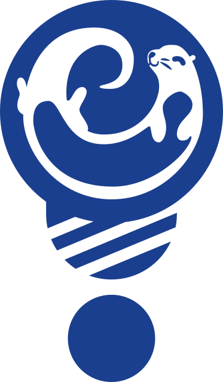

<p align="center">
  
</p>

<h1 align="center">Pomysłownik!</h1>

<p align="center">
  <b>Radar innowacji: istniejące polskie innowacje w jednym miejscu, z oceną i źródłami.</b><br>
  <i>Innovation radar: existing Polish innovations in one place, assessed, with their sources.</i>
</p>

<p align="center">
  Zespół / Team <b>ft_marvins</b> · HackNation 2026 · wyzwanie / challenge „Radar Innowacji” – Podkarpackie Centrum Innowacji (PCI)<br>
  <a href="https://pomyslownik.delta43.net">Demo</a> · <a href="https://demo.delta43.net/docs">API</a> · <a href="docs/api/openapi.yaml">OpenAPI</a> · Licencja / Licence: <a href="LICENSE">EUPL-1.2</a>
</p>

**Polski** · [English](#english)

---

## Polski

### Problem

Polskie innowacje – technologiczne, edukacyjne i administracyjne – są rozproszone po stronach uczelni, urzędów, szkół, platform transferu technologii i rejestrów patentowych. Kto szuka gotowego rozwiązania, zwykle go nie znajduje albo nie wie, czy można mu ufać. W efekcie te same pomysły powstają od nowa, a polska własność intelektualna rzadko trafia do kolejnych wdrożeń.

### Rozwiązanie

Pomysłownik! **automatycznie zbiera istniejące innowacje** z otwartych źródeł, zamienia każdą w **kartę innowacji** i **ocenia ją**. Każda wartość na karcie jest oznaczona jako **fakt potwierdzony** (ze źródłem i cytatem) albo **szacunek** (z opisem metody). Użytkownik może je **wyszukiwać, filtrować i porównywać** według obszaru i swojej grupy odbiorców.

### Jak to działa

1. **Zbieranie** – trzy metody: API (RAD-on, OpenAlex), crawling stron (np. Platforma Transferu Technologii ARP, gov.pl, strony uczelni i miast) z poszanowaniem `robots.txt`, oraz analiza dokumentów PDF. Model AI pomaga tylko czytać źródła.
2. **Karta** – opis, obszar, organizacja, poziom wdrożenia, TRL, źródła z cytatami, dowody liczbowe, historia zmian i „Kto jeszcze nad tym pracuje”.
3. **Ocena** – pięć kryteriów liczonych stałym wzorem z zapisanych dowodów: poziom wdrożenia (koncepcja → prototyp → testy → pilotaż → w praktyce), TRL 1–9, innowacyjność, potencjał zastosowania i wiarygodność. **Model nigdy nie podaje liczby.** Przy braku danych karta mówi „za mało danych”.
4. **Test Oslo** – każda karta przechodzi test innowacji według Podręcznika Oslo (OECD/Eurostat): nowe lub ulepszone, znacząco inne, dostępne lub stosowane.
5. **Odświeżanie** – co 24 godziny worker sprawdza źródła, wykrywa zmiany statusu i zapisuje je w historii karty. Nieaktualne karty są oznaczane.
6. **Wyszukiwanie** – pełnotekstowe (z polskimi znakami i bez), filtry, sortowanie, presety dla sześciu grup odbiorców, porównanie podobnych rozwiązań.

### Najważniejsze funkcje

- Logowanie z wyborem roli (sześć grup odbiorców z zadania); konto demonstracyjne jednym kliknięciem. Logowanie przez login.gov.pl (Profil Zaufany, mObywatel) jest zaprojektowane jako następny krok – [docs/api/AUTH-PROVIDERS.md](docs/api/AUTH-PROVIDERS.md).
- Wyszukiwanie, filtry (obszar, poziom wdrożenia, TRL, region, polskie IP, wiarygodność), sortowanie i porównanie.
- Karty z rozdzieleniem faktów i szacunków, źródłami, cytatami, dowodami i historią zmian.
- Trzy języki interfejsu i treści: polski, angielski, ukraiński. Język wybiera serwer.
- Dostępność (cel: WCAG 2.2 AA): rozmiar tekstu, tryby kontrastu, deklaracja dostępności.
- Anonimowe statystyki użycia (bez identyfikatora użytkownika, małe liczby ukryte).
- Konfigurowalne źródła: nowe API, kanał RSS/Atom, sitemapa lub lista stron w jednym pliku, tokeny w `.env`.

### Dane, założenia i ograniczenia

- **Stan bazy (22.11.2026):** 28 kart (12 technologicznych, 8 edukacyjnych, 8 administracyjnych), 67 źródeł (18 API, 44 strony, 5 dokumentów).
- **Źródła:** RAD-on (OPI PIB), OpenAlex (CC0), Platforma Transferu Technologii ARP, gov.pl, strony uczelni, miast i szkół, raporty PDF, rejestr UPRP (sprawdzany ręcznie). Licencje i regulaminy są opisane w [research/01-sources.md](research/01-sources.md). Z PTT bierzemy tylko link, krótki cytat i nazwę właściciela, z limitem kart.
- **Ręczna weryfikacja:** każde pole „potwierdzone” w kartach startowych zostało sprawdzone przez osobę z zespołu.
- **Ograniczenia:** wagi kryteriów są orientacyjne (do potwierdzenia przez PCI); teksty ukraińskie to tłumaczenie maszynowe i są tak oznaczone; logowanie przez login.gov.pl nie jest jeszcze wdrożone; podobieństwo liczymy na tekście i tagach, bez embeddingów. Metodologia: [research/04-methodology.md](research/04-methodology.md).

### Skala, bezpieczeństwo i ochrona danych

- Kontenery (PostgreSQL, API, worker, web), jeden obraz dla API i workera; nowe źródła bez zmian w kodzie.
- Kontrakt API (OpenAPI) jest jedynym źródłem prawdy; frontend i backend rozwijane są niezależnie, a CI sprawdza kontrakt, testy backendu na prawdziwym PostgreSQL, build frontendu, obrazy i licencje zależności.
- RODO: minimum danych, brak numeru PESEL, usunięcie konta z danymi, statystyki bez identyfikatora użytkownika.
- Ochrona: limity zapytań, tokeny tylko jako skrót, ochrona przed SSRF przy pobieraniu źródeł, tylko tekst i linki http(s) w kartach.

### Uruchomienie

```bash
cp .env.example .env                          # ustaw własne wartości
docker compose --profile full up --build      # web :3000, API :8000
docker compose --profile full run --rm api seed   # migracje, karty startowe, oceny
```
Praca nad frontendem bez backendu: `docker compose --profile mock up` (makieta API na :4010).

---

## English

### Problem

Polish innovations – technological, educational and administrative – are scattered across the sites of universities, public offices, schools, technology-transfer platforms and patent registers. Someone looking for a ready solution usually does not find it, or cannot tell whether to trust it. So the same ideas are built again, and Polish intellectual property rarely reaches new implementations.

### Solution

Pomysłownik! **automatically collects existing innovations** from open sources, turns each into an **innovation card**, and **assesses it**. Every value on a card is marked as a **confirmed fact** (with its source and a quote) or an **estimate** (with its method). Users **search, filter and compare** cards by area and by their audience group.

### How it works

1. **Collection** – three methods: APIs (RAD-on, OpenAlex), web crawling (for example ARP's Technology Transfer Platform, gov.pl, university and city sites) that obeys `robots.txt`, and AI analysis of PDF documents. The model only helps read the sources.
2. **Card** – description, area, organisation, implementation level, TRL, sources with quotes, numeric evidence, change history and "Who else works on this".
3. **Assessment** – five criteria computed by a fixed formula from stored evidence: implementation level (concept → prototype → testing → pilot → in practice), TRL 1–9, innovativeness, application potential and credibility. **The model never produces a number.** With too little data the card says "not enough data".
4. **Oslo test** – every card runs the Oslo Manual (OECD/Eurostat) innovation test: new or improved, significantly different, available or in use.
5. **Refresh** – every 24 hours the worker re-checks the sources, detects status changes and records them in the card's history. Outdated cards are flagged.
6. **Search** – full text (with and without Polish diacritics), filters, sorting, presets for the six audience groups, and a comparison with similar solutions.

### Main functions

- Sign-in with a role (the six audience groups of the task); one-click demo account. Sign-in through login.gov.pl (Profil Zaufany, mObywatel) is designed as the next step – [docs/api/AUTH-PROVIDERS.md](docs/api/AUTH-PROVIDERS.md).
- Search, filters (area, implementation level, TRL, region, Polish IP, credibility), sorting and comparison.
- Cards that keep facts and estimates apart, with sources, quotes, evidence and change history.
- Three languages for the interface and the content: Polish, English, Ukrainian. The server picks the language.
- Accessibility (target: WCAG 2.2 AA): text size, contrast modes, accessibility statement.
- Anonymous usage statistics (no user id, small counts hidden).
- Configurable sources: a new API, RSS/Atom feed, sitemap or page list in one file, tokens in `.env`.

### Data, assumptions and limits

- **Database (22.11.2026):** 28 cards (12 technological, 8 educational, 8 administrative), 67 sources (18 API, 44 web pages, 5 documents).
- **Sources:** RAD-on (OPI PIB), OpenAlex (CC0), ARP's Technology Transfer Platform, gov.pl, university, city and school sites, PDF reports, and the UPRP patent register (checked by hand). Licences and terms are in [research/01-sources.md](research/01-sources.md). From PTT we take only a link, a short quote and the owner's name, with a card limit.
- **Human review:** every "confirmed" field on the starter cards was checked by a team member.
- **Limits:** the criteria weights are indicative (to be confirmed by PCI); Ukrainian texts are machine translations and are labelled as such; login.gov.pl sign-in is not built yet; similarity uses text and tags, not embeddings. Methodology: [research/04-methodology.md](research/04-methodology.md).

### Scale, security and data protection

- Containers (PostgreSQL, API, worker, web); one image for the API and the worker; new sources need no code change.
- The API contract (OpenAPI) is the single source of truth; frontend and backend are developed independently, and CI checks the contract, the backend tests on a real PostgreSQL, the frontend build, the images and dependency licences.
- GDPR: minimal data, no PESEL number, account deletion with its data, statistics without a user id.
- Protection: rate limits, tokens stored only as hashes, SSRF protection when fetching sources, plain text and http(s) links only on cards.

### Run it

```bash
cp .env.example .env                          # set your own values
docker compose --profile full up --build      # web :3000, API :8000
docker compose --profile full run --rm api seed   # migrations, starter cards, scores
```
Frontend work without the backend: `docker compose --profile mock up` (mock API on :4010).

### Add a data source

Sources live in `data/sources/registry.json` (start from `registry.example.json`). Set `method` to `api`, `feed`, `sitemap` or `crawl`; for an API set `baseUrl`, `itemsPath` and a JSONPath `mapping` (at least `title` and `url`). Put the token's variable name in `tokenEnv` and its value in `.env`. Enable a source only after checking its licence. `GET /api/v1/admin/source-config` (admin token) shows readiness and `tokenPresent`, never the token.

### Repository layout

| Folder | Content |
|---|---|
| `backend/` | FastAPI API and worker: collectors, scoring, refresh, translations |
| `frontend/` | Next.js web app (pl, en, uk) |
| `docs/api/` | OpenAPI contract, its review, sign-in design |
| `docs/` | Design, mentor feedback, frontend plan and review ([docs/README.md](docs/README.md)) |
| `data/seed/` | Curated starter cards (JSON, contract format) |
| `data/sources/` | Source registry and collection limits |
| `research/` | Source checks, showcases, methodology, mentor questions |
| `scripts/` | Smoke test, licence check |

### Team

ft_marvins: Delta (backend), Philip (frontend), Alban (design, landing), Karrie (research and verification), Andrei (research), Przemek (logo and brand).

### Licence

EUPL-1.2 – see [LICENSE](LICENSE) (official text from the European Commission's Joinup site). Every dependency is MIT, BSD, Apache-2.0 or EUPL-compatible; CI checks this.
